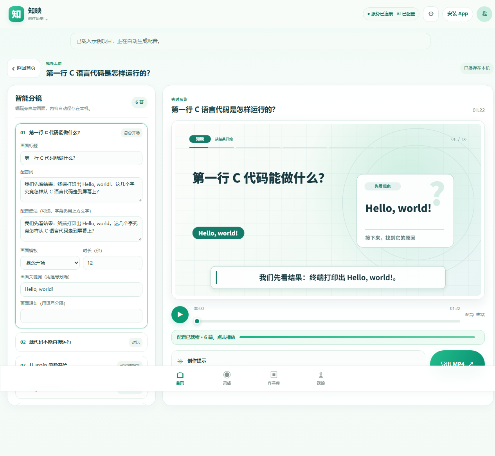

# 知映 · 知识视频创作器（2.1.1）

当前 Android 版本：**2.1.1**（versionCode 14）。移动端优先的薄荷绿创作工作台，含本机历史、视频时长设置、AI 分镜、逐幕编辑、配音、预览和导出。首页支持 AI 优化描述和多份参考资料；灵感、作品库、我的形成可演示的本地社区闭环。生成分镜后自动开始配音，配音与录制进度显示在预览播放器下方。

需要在另一台电脑接手或重建网站时，请先看 [移交说明](HANDOFF.md)。

输入一个知识问题，DeepSeek 生成可编辑的专业教学分镜与完整文字稿；本地模板绘制画面、中文神经语音或 Windows 本机语音配音，浏览器预览并导出带字幕的 MP4。

## 启动

要求：Windows、Node.js 24+、Python 3、FFmpeg，以及 Chrome 或 Edge。神经配音需要联网。

1. 复制 `.env.example` 为 `.env`，填写 `DEEPSEEK_API_KEY`。当前工作区的 `.env` 已配置，且被 `.gitignore` 排除。
2. 运行 `python -m pip install -r requirements.txt`，然后运行 `npm start`。
3. 打开 `http://localhost:4173`。

后端默认只监听 `127.0.0.1`。跨域前端可用 `.env` 中的 `ALLOWED_ORIGINS` 配置精确来源白名单；局域网访问可设置 `HOST=0.0.0.0` 并配置防火墙。公网部署还需要 HTTPS、鉴权与反向代理限流；当前单机限流不等于公网访问控制。

## 手机 App 形态

原型现在带有 PWA 清单、主屏图标和离线缓存的页面外壳。部署到 HTTPS 域名后，Android 可从浏览器安装；iPhone 可在 Safari 中使用“添加到主屏幕”。当前 `localhost` 只供本机开发，手机不能直接访问这台电脑的回环地址。正式给手机使用时，把静态页面和 API 部署到可公网访问的 HTTPS 服务；DeepSeek 密钥只留在后端。生成分镜、配音等 API 不会被 Service Worker 缓存。

没有 API Key 也可以点击“C 语言示例”，体验分镜编辑、配音预览和 MP4 导出。首次导出时保持页面打开，视频会按实际配音长度播放和录制，结束后自动下载。

Android App 支持从本机服务检查并安装新 APK。推荐用 USB + ADB 端口转发连接电脑，不需把开发服务开放到 Wi-Fi；首次需手动安装带升级能力的版本，之后可在 App 内检查更新。发布、签名、连接步骤见 [Android 本机远程升级说明](ANDROID-REMOTE-UPDATE.md)。

## 灵感、作品库与我的（2.1.0）

- 灵感提供推荐、关注、分类、话题、搜索、视频详情与全屏播放。点赞、收藏、关注、评论、回复、精选解答、分享和下载使用同一份本机状态；两条带“演示”标识的可播放示例仅用于展示，没有虚构互动数。
- 创作室成功导出 MP4 后，视频另存到浏览器 IndexedDB，项目才在作品库显示“已完成”。分镜尚可编辑的项目是草稿；生成中只显示当前真实运行的任务。作品库支持筛选、标题搜索、排序、重命名、复制、预览、下载、发布和确认删除。
- 可以从已完成作品发布，或上传不超过 80 MB 的本机 MP4 / WebM；发布可设置标题、简介、封面配色、分类、话题及本机可见范围。我的页面汇总真实项目、发布、收藏、下载请求、评论、关注和本机统计，可编辑头像字符、昵称与简介。
- 社区是**本机演示模式**，没有云端账号、跨用户同步、真实粉丝或审核系统。“公开”只表示当前设备的灵感信息流可见。清除浏览器或 App 数据会移除本机记录与保存的视频。实现与数据关系见 [第三阶段实现说明](PHASE3-IMPLEMENTATION.md)。

## 目前能做什么

- 输入知识点、目标观众和讲解方式，调用 `deepseek-flash` 生成专业分镜。
- 首页「AI 优化」调用同一个 DeepSeek 服务，只修改输入框文案；可继续编辑或恢复原文，不会重置创作设置。
- 首页最多添加 4 份参考资料：PNG/JPEG/WebP/GIF 图片（每张 ≤ 2 MB），可复制文字的 PDF、DOCX、TXT、Markdown（每份 ≤ 5 MB）。图片作为视觉输入交给 AI，文档提取正文后再交给 AI；PDF 最多读前 30 页，单份正文最多取前 6000 字，附件可逐个删除。扫描版 PDF、加密 PDF 和旧版 `.doc` 暂不支持。
- 查看、复制完整文字稿；逐幕修改标题、配音、画面模板、关键词、代码、终端命令和时长；自动保存在当前浏览器。
- 七种可控画面模板：悬念、对比、过程、图解、代码编辑器、运行终端、总结。
- 网站与视频画面统一采用浅色纸张、薄荷绿和柔和蓝色的视觉风格；代码、终端、字幕保持高对比度。
- 网站加入轻量的入场、悬停和加载反馈；视频开场、代码与终端镜头按镜头时间逐步揭示内容，动画会一同进入导出画面。
- 视频预览区更大；字幕按旁白语句分段显示，减少一次铺满整段文字。当前分段时间按文字长度估算，精确逐字同步仍需语音时间戳。
- 中文配音预览和包含配音、字幕的 MP4 导出。
- 生成分镜或载入示例后自动开始生成整条配音，无需先点播放；配音进度、录制进度和转码状态都显示在预览播放器下方，配音就绪后点击播放几乎不用等待。
- 默认使用 Windows 本机离线语音，文字直接合成为 WAV 并跳过逐幕 MP3 转码；也可选三种在线中文音色。在线音色故障时自动退回本机语音。支持语速调整和试听，可为代码术语单独编辑配音读法，字幕保持准确写法。镜头会随实际语音长度调整，减少讲完后的长时间空白。
- 提供“第一行 C 语言代码如何运行”的完整示例，穿插代码编辑器和终端画面。
- [示例文字稿](examples/c-hello-world-script.md) 给出每幕的旁白、画面和操作命令。

## 设计边界

这是现场原型。AI 生成的知识内容仍需创作者核对。视频使用程序化动画，尚未接入图片／视频生成模型；默认离线配音使用 Windows System.Speech，在线预设配音由 `edge-tts` 提供。离线语音在运行后端的 Windows 电脑上合成，不需要本地大模型或 CUDA。当前只支持单人本机使用，暂未实现项目云端保存和互动分支。

后端对 AI、配音和转码接口加了请求大小、并发、频率和超时限制，并限制配音缓存的条目数、内存占用和有效时间。`/api/status` 会实际探测 FFmpeg、在线配音、文档解析和本机语音，缺依赖时首页显示“部分能力不可用”并禁用导出，不会把代码存在当成可用。限制在单个 Node 进程内存中，服务重启后会清空；多实例或公网环境需在反向代理／共享存储层配置统一限流与鉴权。

## 配音方式

Windows 版本通过 System.Speech 本地合成中文离线语音。手机 App 连接电脑后，配音由运行后端的 Windows 电脑生成；电脑保持启动即可。默认直接传 WAV 给浏览器，避免每幕再启动 FFmpeg 压制 MP3。在线预设音色使用 `edge-tts`，需要网络。

## 代码结构

- `server.mjs`：本地 HTTP 服务、DeepSeek 接入、系统配音、FFmpeg 转码。
- `tts.py`：在线中文神经配音。
- `app.js`：分镜编辑、预览播放、录制和导出。
- `renderer.js`：七种视频画面模板。
- `index.html` / `styles.css` / `light.css`：创作界面与浅色主题。

## 赛道说明

产品重点是让普通人从一句话走到可编辑、可导出的知识视频。参考视频展示了提问标题、真实界面或实物、关键词标注和连续配音的交替节奏。现场演示建议先展示 C 语言样片，再输入一个新问题生成第二条分镜，修改其中一幕并预览，最后展示完整文字稿和导出文件。
